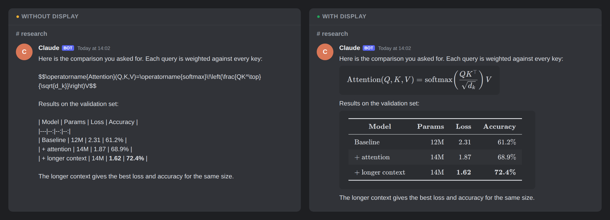

# Display

When Claude shows you math, a table, a chart, a flowchart or a code diff in Discord, it turns it into a picture
before posting, so you see the real thing instead of raw markup.

[繁體中文說明](README.zh-TW.md)



An [Altention](https://github.com/altention/altention) plugin.

## What it does

- **Shows what Discord cannot.** Discord does not typeset math, has no tables and draws no charts. With this plugin,
  Claude in any channel can post these as pictures instead:
  - math and derivations, matrices, chemical formulas
  - tables, including ones with Chinese text or many columns
  - data charts: lines, bars, scatter plots, heat maps
  - flowcharts, sequence diagrams, Gantt charts, timelines, mind maps, dependency graphs
  - code diffs in red and green, one column or side by side
  - terminal output with its colours
  - SVG pictures, HTML pages and pages of a PDF
  - full LaTeX (TikZ drawings, any package) and matplotlib plots
- **Only the part Discord cannot show.** The text of an answer stays ordinary Discord messages you can read and copy;
  only a formula, a table or a diagram becomes a small picture, posted in order with the text that talks about it.
  The whole answer is drawn as one picture only when you ask for it, or when it is a document whose layout matters.
- **Long reports in a few pictures.** A long report drawn whole is cut into several pictures between its parts
  (never right after a heading), with the caption on the first.
- **Made for Discord's dark theme.** Pictures are a dark card that matches Discord; ask for a white background if
  you prefer.
- **Knows when not to.** Commands to copy, short changes, folder trees and small tables of plain letters and numbers
  look fine in Discord's own formatting, so Claude writes those as text. Each thing you are meant to copy goes in a
  message of its own, so that a long press on a phone or tablet copies just that.
- **Catches what slips through.** Before the bot posts Claude's final reply, it hands the reply to display when it
  has display math, a table or a Mermaid diagram written as plain Markdown. Those parts are drawn and the reply is
  posted as text with the pictures in place, even when Claude did not use display itself.

## Requirements

- Altention 0.5.0 or later
- No other plugins.
- Python 3 (already there for Altention).
- Chrome or Chromium, found in this order: the path in `DISPLAY_CHROME`, one installed by Playwright
  (`~/.cache/ms-playwright`), `chromium`, `chromium-browser`, `google-chrome` or `chrome` on your `PATH`, then
  Google Chrome in macOS's Applications folder.
  - Debian, Ubuntu: Playwright's Chrome (about 300 MB, for x86_64 and arm64). It comes from pip, no Node.js; only
    the system libraries it needs take sudo, and a machine with a desktop mostly has them already (a minimal system
    without one: about 300 MB more). Ubuntu's own `chromium` from apt is a snap, which cannot open the pages it is
    given.
    ```sh
    sudo apt update && sudo apt install -y python3-venv
    d=$(mktemp -d) && python3 -m venv "$d" && "$d/bin/pip" install -q playwright==1.64.1
    sudo "$d/bin/playwright" install-deps chromium-headless-shell
    "$d/bin/playwright" install chromium-headless-shell && rm -rf "$d"
    ```
    Without sudo, with the system libraries already there (mostly so on a machine with a desktop): skip the `apt`
    and `install-deps` lines, and run only the venv, `pip install` and `playwright install`; with no `venv` here and
    no sudo, ask someone with sudo to install `python3-venv`.
  - Fedora: `sudo dnf install -y chromium`. Arch: `sudo pacman -S --needed --noconfirm chromium`.
  - macOS: Google Chrome, or `brew install --cask google-chrome`.
- For PDF pages and full LaTeX: poppler (optional, about 5 MB). `sudo apt install -y poppler-utils` (Debian,
  Ubuntu); `sudo dnf install -y poppler-utils` (Fedora); `sudo pacman -S --needed --noconfirm poppler` (Arch);
  `brew install poppler` (macOS).
- For full LaTeX: a way to keep it to its own folders. On Linux, a kernel 5.13 or later with Landlock on (current
  Debian and Ubuntu have it); on macOS, `sandbox-exec`, which comes with it. `display --check` shows it on the
  `sandbox` line.
- For Chinese text: a Chinese font (about 90 MB). `sudo apt install -y fonts-noto-cjk` (Debian, Ubuntu);
  `sudo dnf install -y google-noto-sans-cjk-fonts` (Fedora); `sudo pacman -S --needed --noconfirm noto-fonts-cjk`
  (Arch); macOS has one already.
- For matplotlib plots: Python's `venv` module (optional). `sudo apt install -y python3-venv` (Debian, Ubuntu);
  Fedora, Arch and macOS have it already.
- Everything else is downloaded by the setup step below, into your home folder, without sudo.

## Install

Write in the instance's `plugins.json` where it comes from and which version, then have every machine follow it
(`./install.sh` in `~/altention/engine` on this one, `python3 ~/altention/engine/ops/apply.py <machine>` for others):

```json
{
  "plugins": {"display": {"source": "https://github.com/altention/plugin-display.git", "version": "vX.Y.Z"}}
}
```

On each machine the install:

- clones the plugin to `~/altention/plugins/display`, at that version;
- runs plugin.json's setup "browser": the JavaScript libraries that draw math, charts, diagrams and diffs (from the
  npm registry, about 9 MB, a few seconds), into `~/.cache/altention-display`;
- links the skill as `~/.claude/skills/display`;
- looks for the system tools under Requirements (Chrome, poppler, a Chinese font, python3-venv) and lists the
  missing ones as things for you to do, with this system's command; one that takes sudo is yours to run in your own
  terminal, it never installs them with sudo. poppler and python3-venv are optional: without them, only PDFs, LaTeX
  and matplotlib plots cannot be drawn.

The two large ones are left out of the install; the first time one is needed, Claude runs it as the error says:

- setup "tectonic": Tectonic for full LaTeX (from its GitHub release, about 25 MB), `display --setup tectonic`;
- setup "plot": matplotlib in a Python environment of its own (from PyPI, about 180 MB), `display --setup plot`.

The libraries and Tectonic are fixed versions checked against their checksums. Running a setup again only fetches
what is missing.

`--check` lists what this machine has and ends with the kinds of picture it can draw; `--check chrome` (or
`poppler`, `cjk-font`, `venv`) looks at just that one and exits 0 when it is there, 1 when it is not, and 3 when
this machine cannot tell (no `fc-list`, and the font files' names do not say whether one has Chinese). The plugin
also shows in `python3 ~/altention/engine/ops/plugins.py list`.

## Use

Say it in any channel: 「畫出來」, 「轉成圖」, 「公式看不懂」, "draw it", "make it a picture". Claude also uses it on
its own when a reply holds something Discord would show badly: it posts the answer as a few messages in reading
order, each formula or table as a small picture with the text about it, and ends with the conclusion.

Nothing to say for the final reply: when it holds display math (`$$…$$`, `\[…\]`, `\begin{…}`), a Markdown table or
a ```` ```mermaid ```` block, the bot has display draw those before posting. A reply with none of them is posted as it
is.

You can run it yourself in a terminal too:

```bash
~/altention/plugins/display/bin/display answer.md --segments --post <channel>     # text as text, pictures in between
~/altention/plugins/display/bin/display notes.md --post <channel> --caption "This week's results"   # one picture
```

## Settings

The plugin has no settings of its own in the instance's `plugins.json`. It is on for every machine; to turn it off
on one:

```json
{
  "plugins": {"display": {"disabled_on": ["<machine>"]}}
}
```

- Turn the plugin off on a machine: add the machine to `plugins.display.disabled_on`. The next install or apply on
  that machine takes away its skill link, `~/.claude/skills/display`. Turned off on the machine the bot runs on,
  the bot stops drawing final replies.
- `DISPLAY_CHROME` (environment variable): the Chrome or Chromium to use, when the one it finds is not the one you
  want.
- No schedules.

## Data and privacy

- **Where:** the tools in `~/.cache/altention-display`, and the pictures in `~/.cache/altention-display/out`.
  Pictures older than a day are deleted the next time a picture is made. Full LaTeX also keeps the TeX packages it
  downloads in Tectonic's own cache (`~/.cache/tectonic` on Linux, `~/Library/Caches/Tectonic` on macOS). The
  pictures it posts go to that Discord channel, like any file posted there. On the machine the bot runs on, each
  final reply that has display math, a table or a Mermaid diagram is handed whole to display; the pictures for it
  are kept in the bot's state folder (`rewrite/` in it) for at most 24 hours.
- **The source of a picture:** next to each picture display leaves what it was drawn from
  (`<picture>.png.source.json`), deleted with the picture. When the picture is posted, the bot keeps that source
  with the message (secrets taken out, at most 30 days and 500 messages), and gives it back only when someone
  taps 📝 on the picture.
- **Git:** not in git.
- **Subscription:** never on its own. It does not start Claude; it is a tool the Claude you are already talking to
  uses in that conversation. Turn the plugin off on a machine (above) and Claude there stops using it.
- **Network and your files:** the kinds drawn in the browser (math, tables, charts, diagrams, diffs, terminal
  output, SVG and HTML) are drawn with the network shut off and cannot read files on this machine. An HTML page you
  give it runs in a sandbox: it cannot open other pages or files, so its pictures and fonts have to be inside the
  page. Full LaTeX runs in a sandbox too: it can read and write only a temporary folder of its own, and read the TeX
  packages, fonts and system files it needs; it uses the network only to download TeX packages, and a document
  cannot change the packages later pictures use. matplotlib plots are different, see below.

## Known limitations

- The first full-LaTeX picture on a machine downloads about 45 MB of TeX packages and takes a few minutes; after
  that each one takes a few seconds.
- On a machine without that sandbox (an older Linux kernel, or Landlock turned off), full LaTeX is not drawn at
  all, and Claude is told why.
- A matplotlib plot runs the Python script it is given, as you, with the same access to files and the network as
  any script of yours.
- Charts need their data written into the chart itself; they cannot load it from a file or a web address.
- An HTML page is drawn at most 2000 × 5000 pixels; anything past that is left out, and Claude is told so.
- Pictures are still images: no zooming in or hovering over a point.
- What the bot draws on its own is only display math, tables and Mermaid diagrams in the final reply. Inline math
  such as `$x$` stays as text, and charts, diffs and the rest are drawn only when Claude uses display; so are
  messages Claude posts before its final reply.
- When the drawing takes more than 30 seconds or fails, the bot posts the reply the way it posts any other.

## License

[MIT](LICENSE)

## Development

The full list of kinds, what each takes and its options is in [`skill/SKILL.md`](skill/SKILL.md) (in Chinese, as
the skill Claude reads) and in `bin/display --help`.

- `doc`: Markdown with math (KaTeX), tables (also .csv/.tsv) and ```mermaid blocks; long ones are cut into pictures
- `chart`: a Vega-Lite spec with its data in `data.values`
- `diagram`: Mermaid
- `graph`: Graphviz DOT, drawn in the browser (no Graphviz install)
- `diff`: a unified diff, GitHub style; `--side-by-side`
- `term`: ANSI-coloured terminal output
- `image`: SVG or an HTML page
- `pdf`: pages of a PDF (poppler)
- `tex`: a LaTeX document body, typeset by Tectonic
- `plot`: a matplotlib script, run in the plugin's own venv

The browser kinds are drawn in one headless Chrome with a fresh profile and host names mapped to nothing; input is
escaped or passed as JSON, Markdown takes no HTML, KaTeX runs with `trust: false` and Mermaid with
`securityLevel: strict`. An HTML page is put in a sandboxed `srcdoc` frame inside a page of ours, with a CSP both
outside and in the page (`default-src 'none'`, `frame-src 'none'`), and the picture is only kept when a random mark
of our page is found in both Chrome passes. Tectonic runs with `--untrusted`, under Landlock (Linux) or sandbox-exec (macOS): it may write only its
temporary folder, and the caller's document runs against a throwaway copy of the TeX cache (links to the real one,
which it may only read). The packages it downloaded are then fetched again by name into the real cache by a run
with no TeX of the caller's in it. Downloads are pinned and checked, and
unpacking takes only plain files inside the target folder.

`--setup` takes `browser` (the default), `tectonic`, `plot` or `all`. `DISPLAY_TOOLS` moves the tools folder; to
test from nothing, point it at an empty folder and run `--setup all`.

Tests (each kind this machine can draw is drawn for real; the others are skipped; with PIL the HTML sandbox tests
also check pixels):

```bash
cd ~/altention/plugins/display && python3 -m unittest discover -s tests
```

Decisions behind the design are in [`docs/decisions.md`](docs/decisions.md).
