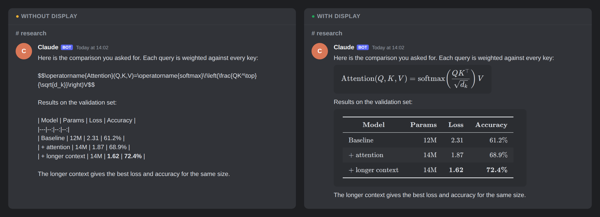

# 顯示（display）

Claude 在 Discord 給你看公式、表格、圖表、流程圖或程式差異時，先轉成圖片再貼，你看到的是排好的樣子，不是原始碼。

[English](README.md)



[Altention](https://github.com/altention/altention) 的插件。

## 它做什麼

- **把 Discord 顯示不了的畫出來。** Discord 不排版公式、沒有表格、不畫圖。開著這個插件，任何頻道的 Claude 都能把這些改成圖片貼出來：
  - 數學式、推導、矩陣、化學式
  - 表格，包括有中文或很多欄的
  - 資料圖表：折線、長條、散佈、熱圖
  - 流程圖、時序圖、甘特圖、時間軸、心智圖、依賴關係圖
  - 程式差異，紅綠標色，單欄或左右對照
  - 有顏色的終端機輸出
  - SVG 圖、HTML 頁面、PDF 的頁面
  - 完整的 LaTeX（TikZ 繪圖、任何套件）和 matplotlib 畫的圖
- **只畫 Discord 顯示不了的那一塊。** 回答的文字照常是 Discord 訊息，看得清楚也能複製；只有公式、表格、流程圖畫成小圖，跟講它的那段文字一起照順序貼出。整份回答畫成一張圖，只在你要求、或它本來就是要看排版的文件時。
- **長報告切成幾張。** 整份畫的長報告會在段落之間切成幾張（不會切在標題正下方），說明跟著第一張。
- **配合 Discord 的深色主題。** 圖是跟 Discord 搭配的深底卡片；想要白底跟 Claude 說就好。
- **不該轉的就不轉。** 要複製的指令、短的改動、資料夾結構、只有英文和數字的小表格，用 Discord 自己的格式就很好看，Claude 會直接寫成文字。要給你複製的東西每一項單獨一則，在手機或平板上長按就只會複製那一項。
- **漏掉的也接得住。** 機器人貼出 Claude 的最後回覆前，回覆裡有用一般 Markdown 寫的獨立數學式、表格或 Mermaid 圖時，會先交給 display：那幾塊畫成圖，回覆照常是文字、圖放在原來的位置。Claude 自己沒用 display 也一樣。

## 需求

- Altention 0.5.0 以上
- 不需要其他插件。
- Python 3（Altention 本來就要）。
- Chrome 或 Chromium，照這個順序找：`DISPLAY_CHROME` 寫的路徑、Playwright 裝的（`~/.cache/ms-playwright`）、`PATH` 上的 `chromium`、`chromium-browser`、`google-chrome` 或 `chrome`，最後是 macOS「應用程式」裡的 Google Chrome。
  - Debian、Ubuntu：用 Playwright 的 Chrome（約 300 MB，x86_64 和 arm64 都有）。它從 pip 裝，不用 Node.js；只有它要的系統函式庫用 sudo 裝，有桌面的機器多半已經有了，沒有桌面的精簡系統另外約 300 MB。Ubuntu 用 apt 裝的 `chromium` 是 snap 版，打不開交給它的頁面，不能用。
    ```sh
    sudo apt update && sudo apt install -y python3-venv
    d=$(mktemp -d) && python3 -m venv "$d" && "$d/bin/pip" install -q playwright==1.64.1
    sudo "$d/bin/playwright" install-deps chromium-headless-shell
    "$d/bin/playwright" install chromium-headless-shell && rm -rf "$d"
    ```
    沒有 sudo、但系統函式庫已經有了（有桌面的機器多半是）的話：跳過 `apt` 和 `install-deps` 那兩行，只跑建 venv、`pip install` 和 `playwright install`；這台沒有 `venv` 又沒有 sudo，就請有 sudo 的人裝 `python3-venv`。
  - Fedora：`sudo dnf install -y chromium`。Arch：`sudo pacman -S --needed --noconfirm chromium`。
  - macOS：Google Chrome，或 `brew install --cask google-chrome`。
- PDF 的頁面和完整 LaTeX 要 poppler（選用，約 5 MB）：`sudo apt install -y poppler-utils`（Debian、Ubuntu）；`sudo dnf install -y poppler-utils`（Fedora）；`sudo pacman -S --needed --noconfirm poppler`（Arch）；`brew install poppler`（macOS）。
- 完整 LaTeX 要能把它關在自己的資料夾裡：Linux 要 kernel 5.13 以上、開著 Landlock（現在的 Debian、Ubuntu 都有）；macOS 用內建的 `sandbox-exec`。`display --check` 的 `sandbox` 那行看得到。
- 中文要有中文字型（約 90 MB）：`sudo apt install -y fonts-noto-cjk`（Debian、Ubuntu）；`sudo dnf install -y google-noto-sans-cjk-fonts`（Fedora）；`sudo pacman -S --needed --noconfirm noto-fonts-cjk`（Arch）；macOS 本來就有。
- matplotlib 的圖要 Python 的 `venv` 模組（選用）：`sudo apt install -y python3-venv`（Debian、Ubuntu）；Fedora、Arch、macOS 本來就有。
- 其他東西由下面的安裝步驟下載到你的家目錄，不用 sudo。

## 安裝

在實例的 `plugins.json` 寫它從哪來、用哪一版，再讓每台照著做（這台在 `~/altention/engine` 跑 `./install.sh`，別台用 `python3 ~/altention/engine/ops/apply.py <機器>`）：

```json
{
  "plugins": {"display": {"source": "https://github.com/altention/plugin-display.git", "version": "vX.Y.Z"}}
}
```

每台的安裝會：

- 把插件 clone 到 `~/altention/plugins/display`，切到那一版；
- 跑 plugin.json 裡的 setup「browser」：畫公式、圖表、流程圖和差異用的 JavaScript 函式庫（從 npm registry，約 9 MB，幾秒鐘），放在 `~/.cache/altention-display`；
- 把 skill 連到 `~/.claude/skills/display`；
- 檢查上面「需求」裡的系統工具（Chrome、poppler、中文字型、python3-venv），缺的列成要你做的事，附上這個系統的裝法；要 sudo 的請你在自己的終端機跑，不會自己用 sudo 裝。poppler 和 python3-venv 是選用的，少了只是不能畫 PDF、LaTeX 和 matplotlib 的圖。

另外兩項比較大，安裝時不裝，第一次用到時 Claude 會照錯誤訊息自己跑：

- setup「tectonic」：完整 LaTeX 用的 Tectonic（從它的 GitHub release，約 25 MB），`display --setup tectonic`；
- setup「plot」：放在獨立 Python 環境裡的 matplotlib（從 PyPI，約 180 MB），`display --setup plot`。

函式庫和 Tectonic 是固定版本，下載後會比對校驗碼；再跑一次只會補缺的。

`--check` 列出這台有什麼，最後一行是這台能畫的種類；`--check chrome`（或 `poppler`、`cjk-font`、`venv`）只看一項，有就結束碼 0，沒有是 1，這台查不了是 3（沒有 `fc-list`，字型檔的名字也看不出有沒有中文字型）。`python3 ~/altention/engine/ops/plugins.py list` 也看得到這個插件。

## 用法

在任何頻道說「畫出來」「轉成圖」「公式看不懂」都可以。回覆裡有 Discord 會顯示得很差的內容時，Claude 也會自己用：把回答照閱讀順序分成幾則貼，公式或表格畫成小圖、跟講它的文字放在一起，最後一則是結論。

最後回覆不用特別說：裡面有獨立的數學式（`$$…$$`、`\[…\]`、`\begin{…}`）、Markdown 表格或 ```` ```mermaid ```` 區塊時，機器人會先讓 display 畫好再貼。都沒有的回覆照原樣貼。

也可以自己在終端機跑：

```bash
~/altention/plugins/display/bin/display answer.md --segments --post <頻道>     # 文字照常是文字，圖插在中間
~/altention/plugins/display/bin/display notes.md --post <頻道> --caption "這週的結果"   # 畫成一張
```

## 設定

這個插件在實例的 `plugins.json` 裡沒有自己的設定。它在每台都開著；要在某台關掉：

```json
{
  "plugins": {"display": {"disabled_on": ["<機器>"]}}
}
```

- 在某台關掉這個插件：把那台加進 `plugins.display.disabled_on`。那台下次 install 或 apply 時會拿掉它的 skill
  連結 `~/.claude/skills/display`。在機器人那台關掉，機器人就不再畫最後回覆。
- `DISPLAY_CHROME`（環境變數）：要用哪個 Chrome 或 Chromium，在它找到的不是你要的那個時設。
- 沒有排程。

## 資料與隱私

- **存在哪：** 工具在 `~/.cache/altention-display`，圖在 `~/.cache/altention-display/out`。超過一天的圖會在下次畫圖時刪掉。完整 LaTeX 下載的 TeX 套件另外放在 Tectonic 自己的快取（Linux 是 `~/.cache/tectonic`，macOS 是 `~/Library/Caches/Tectonic`）。貼出去的圖會在那個 Discord 頻道裡，跟其他貼上去的檔案一樣。機器人那台，每則有獨立數學式、表格或 Mermaid 圖的最後回覆會整份交給 display；畫出的圖放在機器人的狀態資料夾（裡面的 `rewrite/`），最多留 24 小時。
- **圖的原文：** display 在每張圖旁邊留一份它是從什麼畫的（`<圖>.png.source.json`），跟圖一起刪。圖貼出去後，機器人會把原文跟那則訊息一起記下（拿掉秘密，最多 30 天、500 則），有人在圖上按 📝 才回出來。
- **git：** 不進 git。
- **訂閱額度：** 自己不會花。它不會啟動 Claude，只是你正在對話的那個 Claude 在對話裡用的工具。在某台關掉插件（見上面），那台的 Claude 就不會再用。
- **網路和你的檔案：** 用瀏覽器畫的種類（公式、表格、圖表、流程圖、差異、終端機輸出、SVG 和 HTML）畫的時候網路是關掉的，也讀不到這台的檔案。你給它的 HTML 頁面在沙箱裡跑：不能開別的頁面或檔案，所以頁面要用的圖片和字型要放在頁面裡面。完整 LaTeX 也在沙箱裡跑：只能讀寫自己的暫存資料夾，以及讀它需要的 TeX 套件、字型和系統檔案；只有下載 TeX 套件時用網路，文件也改不到之後別張圖用的套件。matplotlib 不一樣，見下面。

## 已知限制

- 一台機器第一次畫完整 LaTeX 時要下載約 45 MB 的 TeX 套件，要等幾分鐘；之後每張幾秒鐘。
- 沒有那個沙箱的機器（較舊的 Linux kernel，或 Landlock 被關掉）完全不畫完整 LaTeX，並告訴 Claude 原因。
- matplotlib 的圖會用你的身分執行交給它的 Python 腳本，能碰的檔案和網路跟你自己跑的腳本一樣。
- 圖表的資料要直接寫在圖表裡，不能從檔案或網址讀。
- HTML 頁面最多畫 2000 × 5000 像素，超過的部分不畫，會告訴 Claude。
- 圖是靜態的：不能放大，也不能把滑鼠移到某個點上看數值。
- 機器人自己會畫的只有最後回覆裡的獨立數學式、表格和 Mermaid 圖。行內的 `$x$` 留在文字裡；圖表、程式差異等其他種類，以及最後回覆之前 Claude 貼的訊息，只有 Claude 用 display 時才會畫。
- 畫超過 30 秒或失敗時，機器人照它平常的方式貼出回覆。

## 授權

[MIT](LICENSE)

## 開發

每一種的完整寫法和選項在 [`skill/SKILL.md`](skill/SKILL.md)（就是 Claude 讀的那份 skill）和 `bin/display --help`。

- `doc`：Markdown，可以有公式（KaTeX）、表格（.csv／.tsv 也行）、```mermaid 區塊；太長自動切成幾張
- `chart`：Vega-Lite spec，資料寫在 `data.values`
- `diagram`：Mermaid
- `graph`：Graphviz DOT，在瀏覽器裡畫（不用裝 Graphviz）
- `diff`：unified diff，GitHub 的樣式；`--side-by-side`
- `term`：有 ANSI 顏色的終端機輸出
- `image`：SVG 或 HTML 頁面
- `pdf`：PDF 的頁面（poppler）
- `tex`：LaTeX 文件的內容，用 Tectonic 編
- `plot`：matplotlib 腳本，在插件自己的 venv 裡跑

瀏覽器類都在同一個 headless Chrome 裡畫，每次用新的設定檔、所有主機名稱都解析不到；輸入先跳脫或以 JSON 放進頁面，Markdown 不收 HTML，KaTeX 用 `trust: false`，Mermaid 用 `securityLevel: strict`。HTML 頁面放在我們頁面裡的 sandbox `srcdoc` iframe，外層和頁面裡都有 CSP（`default-src 'none'`、`frame-src 'none'`），兩次 Chrome 都要找到我們頁面的隨機標記才留下圖。Tectonic 用 `--untrusted`，並在 Landlock（Linux）或 sandbox-exec（macOS）裡跑：只能寫自己的暫存資料夾；呼叫者的文件用一份用完就丟的 TeX 快取（每個檔都連到真的快取，只能讀）。它下載的套件，之後再由一個不含呼叫者 TeX 的執行照檔名抓進真的快取。下載的東西固定版本、比對校驗碼，解壓只收目標資料夾裡的一般檔案。

`--setup` 可以接 `browser`（預設）、`tectonic`、`plot` 或 `all`。`DISPLAY_TOOLS` 可以換工具資料夾的位置；要從零測，指到空的資料夾再跑 `--setup all`。

測試（這台能畫的種類每種都真的畫一張，其他的跳過；有 PIL 時，HTML 沙箱的測試也會檢查像素）：

```bash
cd ~/altention/plugins/display && python3 -m unittest discover -s tests
```

設計上的決定在 [`docs/decisions.md`](docs/decisions.md)。
